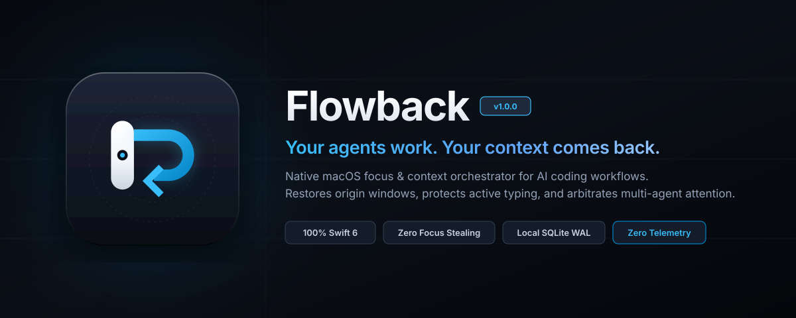
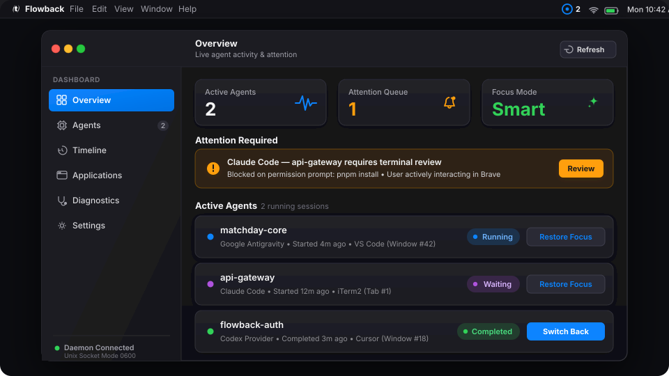
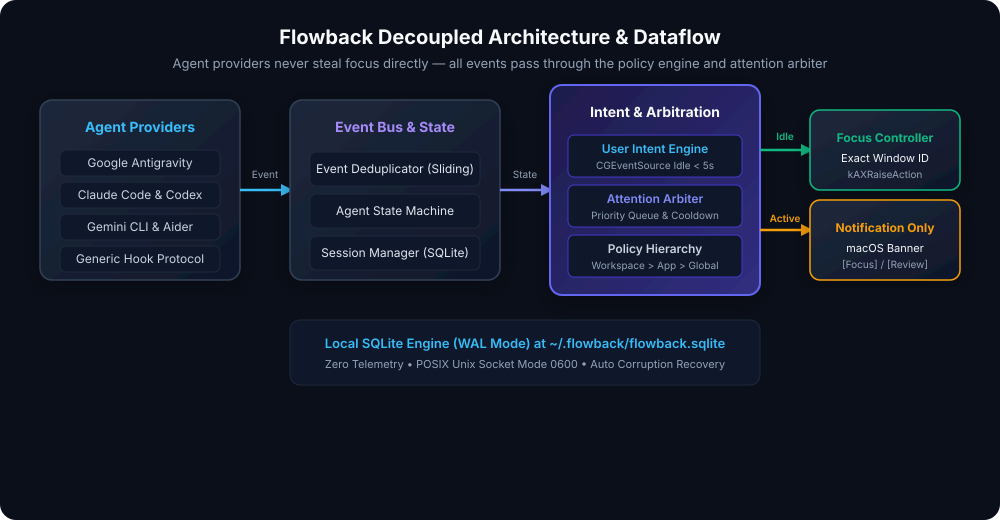

<div align="center">
  

  <p align="center">
    <strong>Your agents work. Your context comes back.</strong>
  </p>

  <p align="center">
    <a href="https://github.com/rapheljr/flowback/actions/workflows/ci.yml"></a>
    <a href="https://github.com/rapheljr/flowback/releases"></a>
    <a href="LICENSE"></a>
    
    
  </p>
</div>

---

## 1. Positioning Statement

> **Flowback** is a native macOS context and focus manager for AI coding agents. Track agent sessions, preserve application and workspace context, and intelligently decide when to return focus or notify you.

---

## 2. The Problem

AI coding agents (Google Antigravity, Claude Code, OpenAI Codex, Gemini CLI, Aider) execute multi-minute background tasks: refactoring files, installing dependencies, running integration tests, or searching large codebases. 

While the agent works, you switch context—reviewing a PR on GitHub, reading documentation in Brave, or communicating on Slack. When the agent finishes:

* **Without Flowback:**
  * **Option A:** You miss that the agent finished or needs permission, leaving your workstation idle for 20 minutes.
  * **Option B:** A crude notification script or shell hook blindly steals focus and raises your editor window right while you are in the middle of typing a sentence, swallowing keystrokes and interrupting your train of thought.
  * **Option C:** If three agents finish at once, your desktop frantically jumps between spaces and windows in a storm of window thrashing.

* **With Flowback:**
  Flowback captures the exact origin context (window ID, workspace path, process ID). When the agent stops:
  * If you are **idle** (> 5 seconds of keyboard/mouse inactivity), it smoothly and accurately restores the exact origin window (`VS Code → matchday`).
  * If you are **actively typing**, it suppresses focus-stealing and displays an actionable macOS notification with `[Focus Window]` and `[Review]` buttons.
  * If multiple agents complete simultaneously, an Attention Arbiter aggregates them into a single summary with cooldown timers.

---

## 3. Product Demonstration & Interface

Flowback runs as a lightweight native menu bar application accompanied by a native SwiftUI Dashboard and command-line companion (`flowback`):

<div align="center">
  
</div>

---

## 4. Key Capabilities

* **100% Swift 6 Concurrency & Native AppKit:** Zero Electron, zero local web servers, zero background CPU polling loops when idle.
* **Exact Window Restoration Hierarchy:** Section 14 resolution: Numeric Window ID (`AXUIElement`) → Workspace Title Match → Process ID (`PID`) → Bundle Identifier → Graceful fallback.
* **User Intent Engine:** Senses system idle duration via `CGEventSource`. Never steals focus if you pressed a key or clicked a mouse button in another application within 5 seconds.
* **Attention Arbiter & Priority Ordering:** Prioritizes urgent agent states (`permissionRequired` > `failure` > `completed` > `waiting` > `informational`). 1000ms focus cooldown prevents rapid window thrashing.
* **Focus Lock Mode:** Temporarily silence auto-restoration (15m, 30m, 45m, 1h, or indefinite) while keeping notification banners intact.
* **Local-First & Private:** Local SQLite persistence with Write-Ahead Logging (WAL mode) at `~/.flowback/flowback.sqlite`. Zero telemetry, zero cloud calls, zero code inspection.
* **Proactive Agent Discovery:** Continuously indexes running agent transcripts and live sessions in addition to hook events.

---

## 5. Supported Agents & Integration Matrix

| Agent / Provider | Status | Integration Mechanism | Hook & Lifecycle Details |
|---|---|---|---|
| **Google Antigravity** | **Supported** | Official JSON Hooks + Transcript Scan | `~/.gemini/config/hooks.json` (`PreInvocation`, `PostInvocation`, `Stop` with `fullyIdle=true` prioritization) |
| **Claude Code** | **Supported** | Process & Terminal Hooks | Automatic hook detection and terminal session lifecycle |
| **OpenAI Codex** | **Supported** | Process & CLI Hooks | Process monitoring and state translation |
| **Gemini CLI** | **Supported** | CLI Hook Integration | Post-execution hook callback |
| **Aider** | **Supported** | Git & Terminal Integration | File watcher and terminal notification |
| **Generic Hook Protocol** | **Supported** | POSIX Unix Domain Socket | Emits schema v1 JSON over `~/.flowback/flowback.sock` |
| **Windsurf / OpenCode** | **Partial support** | Editor & Process Adapter | Active transcript scanning; native hooks planned |
| **Cursor Background Agent** | **Partial support** | Editor Adapter & IPC | Window restoration supported; subagent hook planned |
| **Custom Local Scripts** | **Supported** | CLI Emit | `flowback emit '{"event":"agent.completed",...}'` |

### Supported Editors & Terminals
* **Editors:** Google Antigravity IDE, Visual Studio Code (Stable, Insiders, OSS), Cursor, Windsurf, VSCodium, Positron, Trae.
* **Terminals:** Apple Terminal, iTerm2, Kitty, Alacritty, Ghostty, Warp.
* **Browsers:** Brave, Google Chrome, Safari, Microsoft Edge, Arc.

---

## 6. How Flowback Works

Flowback enforces **strict architectural decoupling**. Agent providers **NEVER** manipulate macOS focus directly:

```text
Provider Hook / Scan → AgentEvent → EventBus → Deduplicator → SessionManager → PolicyEngine → AttentionArbiter → FocusController
```

<div align="center">
  
</div>

1. **Origin Capture:** When an agent starts, Flowback captures an `OriginContext` containing the active window ID, workspace root, process ID, and bundle identifier.
2. **Event Normalization:** Agent events pass through a sliding-window deduplicator and transition through a formal finite state machine (`AgentStateMachine`).
3. **Intent Detection:** When a completion occurs, `UserIntentEngine` inspects system idle seconds.
4. **Arbitration:** `AttentionArbiter` groups simultaneous completions occurring within 1.5 seconds.
5. **Context Restoration:** If idle, `FocusController` invokes `kAXRaiseAction` on the origin window. If active, `NotificationManager` presents an interactive banner.

---

## 7. Comparison: Notification Scripts vs. Flowback

| Capability | Generic Notification Script | Blind Focus Switcher | Flowback |
|---|---|---|---|
| **Origin Window ID Memory** | ❌ No | ❌ No | ✅ Exact Window ID |
| **Workspace Matching** | ❌ No | ❌ No | ✅ Workspace Pattern Match |
| **Active Typing Detection** | ❌ No | ❌ No (Steals Focus) | ✅ Suppresses Focus Steal |
| **Simultaneous Agent Aggregation** | ❌ No | ❌ No (Thrashing) | ✅ Attention Arbiter |
| **Focus Lock** | ❌ No | ❌ No | ✅ 15m–Indefinite Presets |
| **Local SQLite History** | ❌ No | ❌ No | ✅ SQLite WAL Mode |
| **Native Menu Bar & Dashboard** | ❌ No | ❌ No | ✅ Native SwiftUI |

---

## 8. Installation

### Requirements
* macOS 14.0 (Sonoma) or newer (Apple Silicon & Intel)

### Option 1: DMG Installer (Recommended)
1. Download `Flowback-1.0.0-arm64.dmg` from the [Releases](https://github.com/rapheljr/flowback/releases) page or [Website Download](https://rapheljr.github.io/flowback/download/).
2. Mount the DMG and drag `Flowback.app` to `/Applications`.
3. Link the bundled CLI tool:
   ```bash
   sudo ln -sf /Applications/Flowback.app/Contents/Resources/flowback /usr/local/bin/flowback
   ```

### Option 2: Homebrew Cask (Upcoming)
```bash
brew tap rapheljr/flowback
brew install --cask flowback
```

For Gatekeeper troubleshooting and uninstallation instructions, see [INSTALLATION.md](INSTALLATION.md).

---

## 9. Quick Start Guide

### 1. Launch Flowback
```bash
open -a Flowback
```
The Flowback icon will appear in your macOS status bar.

### 2. Verify Diagnostics
```bash
flowback doctor
```

### 3. Check Live Agents
```bash
flowback status
flowback agents
```

### 4. Test Focus Restoration
```bash
flowback test-focus
```

---

## 10. Configuration Examples

Settings can be customized via the Dashboard Settings tab or in `~/.flowback/config.json`:

```json
{
  "global": {
    "idleThresholdSeconds": 5.0,
    "cooldownDurationMs": 1000,
    "spacesPolicy": "neverSwitchSpaces",
    "restoreFullscreen": false
  },
  "workspaces": {
    "/Users/username/src/sensitive-repo": {
      "autoRestoreOnCompletion": false,
      "notificationOnly": true
    }
  }
}
```

See [Docs/CONFIGURATION.md](Docs/CONFIGURATION.md) for full options.

---

## 11. Permissions and Privacy

Flowback is built on a **least-privilege, zero-trust, local-only** model:

* **Accessibility (`AXUIElement`):** Required solely to query window titles and raise specific background windows. If denied, Flowback degrades gracefully to application-level switching.
* **Notifications (`UNUserNotificationCenter`):** Required to deliver actionable completion alerts when you are actively typing.
* **Privacy Guarantee:**
  * ❌ Zero outbound network requests.
  * ❌ Zero telemetry, analytics, or tracking.
  * ❌ Zero keystroke logging or mouse coordinate tracking.
  * ❌ Zero source code, prompt, or secret extraction.

Read the full [Privacy Manifesto](PRIVACY.md).

---

## 12. Supported macOS Versions & Architectures

* **macOS 14.0+ Sonoma:** Fully supported (Apple Silicon & Intel).
* **macOS 15.0+ Sequoia:** Fully supported (Apple Silicon & Intel).
* **Hardware:** Native Apple Silicon (`arm64`) and Intel (`x86_64`).

---

## 13. Build from Source

```bash
# Clone the repository
git clone https://github.com/rapheljr/flowback.git
cd flowback

# Build release targets
bash Scripts/build.sh

# Assemble signed application bundle
bash Scripts/package_app.sh

# Build disk image
bash Scripts/create_dmg.sh
```

---

## 14. Testing & Development

Flowback includes a deterministic test harness executing 61 comprehensive verification assertions:

```bash
# Run the verification test suite
swift run FlowbackTestRunner
```

Expected output:
```text
================================================================
TEST RESULTS SUMMARY
Total tests executed: 61
Passed: 61
Failed: 0
================================================================
ALL VERIFICATION SUITES PASSED! ✓
```

See [DEVELOPMENT.md](DEVELOPMENT.md) for developer documentation.

---

## 15. Contributing

Contributions are welcome! Please read [CONTRIBUTING.md](CONTRIBUTING.md) for guidelines on:
* Environment setup
* Conventional commit standards
* Adding new agent providers or editor adapters
* PR submission checklists

All contributors are expected to uphold our [Code of Conduct](CODE_OF_CONDUCT.md).

---

## 16. License

This project is licensed under the **MIT License**. See the [LICENSE](LICENSE) file for details.
Copyright (c) 2026 Abin Rapheal and Flowback Contributors.

Third-party notices and licenses are documented in [THIRD_PARTY_NOTICES.md](THIRD_PARTY_NOTICES.md).

---

## 17. Security Reporting

Please **DO NOT** report security vulnerabilities through public GitHub issues.
Report privately via GitHub Security Advisories:
👉 **[Report a Security Vulnerability](https://github.com/rapheljr/flowback/security/advisories/new)**

Review our response targets and disclosure policies in [SECURITY.md](SECURITY.md).

---

## 18. Roadmap

* 🟢 **v1.0.0:** Universal core, official providers (Antigravity, Claude Code, Codex), Attention Arbiter, User Intent Engine, SQLite WAL, SwiftUI Dashboard & CLI.
* 🔵 **v1.1.0:** Multi-monitor display pinning, official Homebrew Cask, terminal tab deep links.
* 🔵 **v1.2.0:** Multi-agent workspace grouping presets, scheduled Focus Lock.
* 🟣 **v2.0.0:** Out-of-process provider sidecar architecture.

Read the full [ROADMAP.md](ROADMAP.md).

---

## 19. FAQ & Known Limitations

* **macOS Spaces Limitation:** By default, Flowback follows `neverSwitchSpaces` to avoid disorienting desktop jumping. It displays a notification banner on your current Space instead. Space switching can be enabled in Settings.
* **Permission Fallback:** Without Accessibility permissions, Flowback activates the target application via `NSWorkspace` instead of raising a specific window.
* **Full FAQ:** See [Docs/FAQ.md](Docs/FAQ.md).

---

## 20. Project Links & Resources

* 🌐 **Marketing Website:** [https://rapheljr.github.io/flowback/](https://rapheljr.github.io/flowback/)
* 📦 **Downloads Page:** [https://rapheljr.github.io/flowback/download/](https://rapheljr.github.io/flowback/download/)
* 📚 **Documentation Hub:** [Docs/README.md](Docs/README.md)
* 🚀 **GitHub Releases:** [https://github.com/rapheljr/flowback/releases](https://github.com/rapheljr/flowback/releases)
* 💬 **GitHub Discussions:** [https://github.com/rapheljr/flowback/discussions](https://github.com/rapheljr/flowback/discussions)
* 🐛 **Issue Tracker:** [https://github.com/rapheljr/flowback/issues](https://github.com/rapheljr/flowback/issues)
* 📋 **Changelog:** [CHANGELOG.md](CHANGELOG.md)
* ⚖️ **Project Governance:** [GOVERNANCE.md](GOVERNANCE.md)
